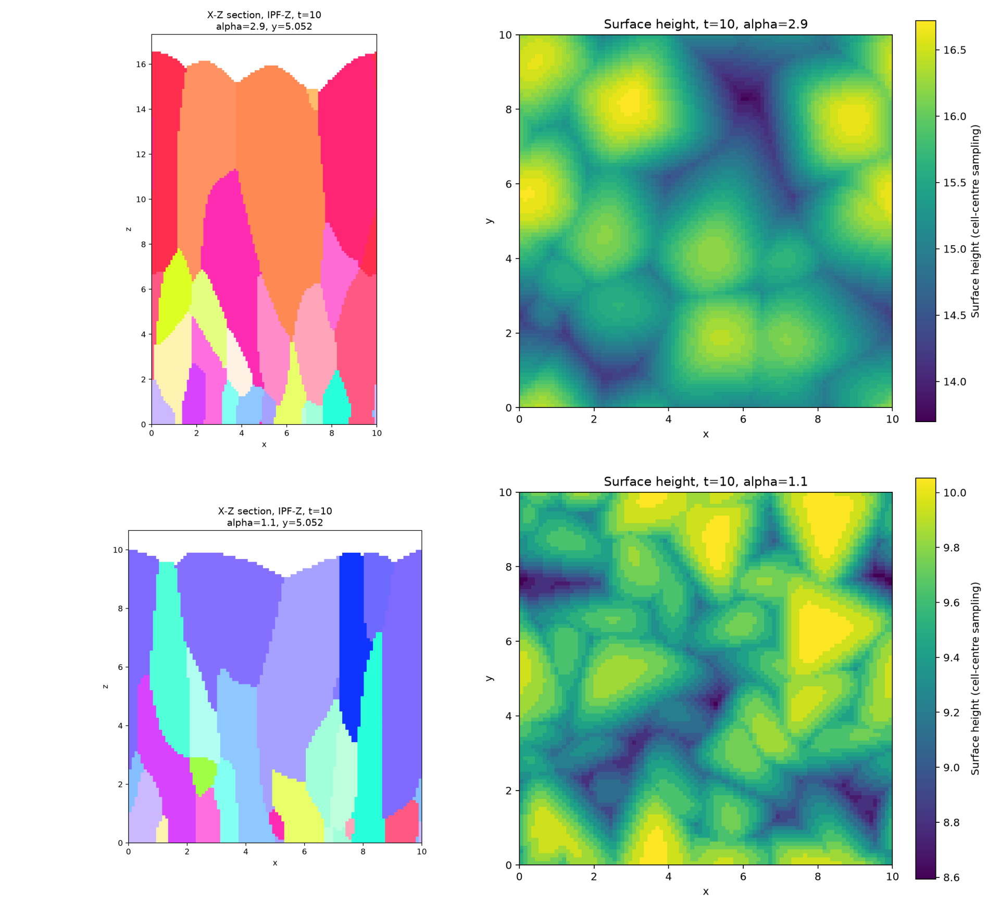
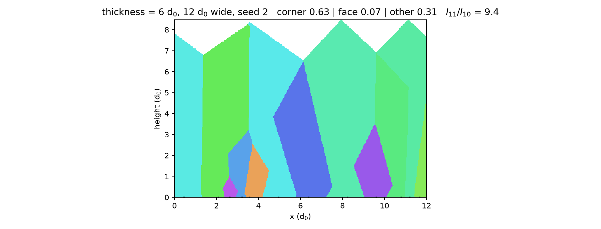

# Polycrystalline film growth simulations

## 3次元ファセット成長（Smereka et al., 2005）

[モデル・実行方法・検証範囲](docs/faceted3d.md)を参照。
{001}/{111} ファセット速度比を変え、XZ断面のIPF-Z図とXY表面高さ図を生成する。
論文の kinetic Wulff 形に基づく**近似実装**であり、著者らの式(7)の完全な再実装や、
査読者から提供された画像とのピクセル単位の一致を主張するものではない。



同じ121核・同じ初期方位から、α=2.9では〈100〉寄り、α=1.1では〈111〉寄りの
配向が得られた。3次元での初期核への連結性を監査済み。
**表面の稜の鋭さや絶対高さは参考画像と異なり、定量的再現は未達**。
[計算条件・20テスト・格子比較・誤差の詳細](docs/faceted3d.md)と
[断面外での接続を示す図](results/3d/111_section_connection.png)を参照。

## 2次元の予備実装（Wild et al., 1990）

> 以下は既存の探索的結果。連結性の検査は、成長方程式・境界条件・数値収束の
> 検証の代わりにはならない。領域外の核を窓端へ丸める既存処理も未修正である。
> 既存の「厳密」「一致」という記述や数値を、
> 検証済みの物理的再現として引用しないこと。3次元版は別のソルバを使用する。

Wild, Herres & Koidl, *Texture formation in polycrystalline diamond films*,
J. Appl. Phys. **68**, 973 (1990) — Sec. IV「Growth modeling」の 2 次元
evolutionary-selection モデルの実装。

論文 Fig. 8（計算した多結晶組織）と Fig. 9（膜厚に対する 11/10 配向の体積比）の
再現を目的とする。Fig. 2–6 は 3 次元の結晶方位の実験なので対象外。



*膜厚 6 d0・幅 12 d0・seed 2 の計算組織（論文 Fig. 8 相当）。黒い正方形が初期核、
色は結晶方位、上面は角でできた鋸歯状プロファイル。角上 0.63 / 面上 0.07 / その他 0.31、
I₁₁/I₁₀ = 9.4。窓の外から入ってきた結晶は核マーカーを持たない。*

## モデル（論文 Sec. IV の仮定そのまま）

- 基板上に正方形の核をランダムな位置・ランダムな方位で置く（方位は 90° 周期）。
- 各面に垂直な成長速度 `v` は方位によらず一定（無限表面拡散）。
- 結晶は隣接結晶に覆われた領域を失う（evolutionary selection）。覆われた部分も
  体積には数えるが、表面には出ない。

## 実装：到達時刻＋連結制約つきの成長

仮定そのままだと、核 `i`（位置 `c_i`、方位 `φ_i`）から時間 `t` 育った結晶は自身の
座標系の正方形で、点 `x` への到達時刻は閉じた形で書ける。

    τ_i(x) = max(|u_i|, |w_i|) / v,   (u, w) = R(-φ_i) (x - c_i)

**ただし「τ が最小の結晶がその点を占有する」だけでは物理的でない。** 結晶は自分の
表面を前進させてしか広がれないので、隣に覆われた領域の向こう側に同じ結晶が
再出現してはいけない。τ の大小だけを見るとそれが起きる（実際、窓 12 d0・核 16 個の
計算で 9 個の結晶が核から切り離された島を持ち、膜の途中から結晶が生えたように
見えた）。論文 Fig. 8 の結晶はすべて基板から連続した柱なので、モデルは分割式では
なく成長として解く必要がある。

そこで τ を「鍵」に使う**単調フラッド**で前線を進める。

- 各核のピクセルを時刻 0 で占有させる。
- 前線は、同じ結晶が既に所有する隣接ピクセル（そこでの到達時刻がこれ以下）から
  しか進めない。候補時刻は τ_i そのもの＝正方形の面が実際に進む厳密な時刻。
- したがって各結晶の領域は核に連結で、覆われた結晶はそこで終わる。

単一結晶では τ の厳密解と一致し（最大差 2e-6 d0）、多結晶では浮遊片が出ないことを
`tests` で検査している。膜厚 `d` は前線時刻が `d` 以下の領域として切り出す。

単位は `d0 = 1`（平均核間距離）、`v = 1`（膜厚 = 成長時間）。

## 使い方

```bash
uv sync                                     # numpy / matplotlib / pytest
uv run bin/structure.py --width 12 --thickness 6 --seed 2 \
    --out results/structure_t6_d0.png       # Fig. 8 相当の組織図
uv run bin/thickness_scan.py --width 1200 --tmax 50 --seeds 3 \
    --out-prefix results/scan_continuous    # Fig. 9 相当の膜厚スキャン
uv run pytest -q                            # 10 tests
```

主なオプション:

| オプション | 意味 |
|---|---|
| `--width`, `--thickness` / `--tmax` | 計算窓の幅・膜厚（単位 d0） |
| `--px-per-d0` | グリッド分解能（px / d0） |
| `--height-factor` | グリッド高さ / 膜厚。角が上を向いた結晶は √2 倍の高さに達するので 1.6 が既定 |
| `--angles continuous\|two-class` | 方位の分布。`continuous` は論文の記述どおり連続一様、`two-class` は角上・面上の 2 値のみ |
| `--method connected\|analytic` | `connected`（既定）は連結制約つきの成長。`analytic` は τ の最接近分割で、単結晶の照合専用（浮遊片が出る） |
| `--tol` | 角上／面上とみなす角度窓（既定 10°） |
| `--seeds` | 独立試行の平均 |
| `--density` | 核密度（1/d0） |

窓の外側の核も競争に効くので、内部が厳密になるよう
`pad = 2 × 膜厚` の核を自動で生成している（`τ >= |Δx|/√2` なので 2 倍で十分）。

## 結果（`results/scan_continuous.*`, 幅 1200 d0, 3 seeds, tol 10°）

| 膜厚 (d0) | 角上 (11) | 面上 (10) | その他 | I₁₁/I₁₀ | 表面結晶の平均幅 (d0) |
|---|---|---|---|---|---|
| 1 | 0.226 | 0.224 | 0.550 | 1.0 | 1.24 |
| 10 | 0.400 | 0.075 | 0.525 | 5.4 | 3.33 |
| 20 | 0.530 | 0.036 | 0.433 | 14.6 | 5.11 |
| 30 | 0.613 | 0.024 | 0.363 | 25.7 | 6.22 |
| 40 | 0.673 | 0.018 | 0.309 | 37.9 | 7.21 |
| 50 | 0.721 | 0.014 | 0.265 | 51.1 | 8.42 |

## 論文の主張との照合

| 論文の主張 | 本実装 | 判定 |
|---|---|---|
| 初期核はランダム配向（Fig. 5 の外挿で I₂₂₀/I₁₁₁ ≈ 0.4） | d = 1 d0 で角上 0.226 / 面上 0.224（＝ほぼ 1:1） | 一致 |
| 配向は膜厚とともに発達する | I₁₁/I₁₀ が 1.0 → 51.1 と単調増加 | 一致 |
| 面上結晶（10 配向）は速やかに覆われる | 面上の面積分率 0.224 → 0.014 | 一致 |
| 平均粒径が膜厚とともに増大する | 表面結晶幅 1.2 → 8.4 d0 | 一致 |
| 角が上を向いた結晶が生き残る | 角上分率 0.23 → 0.72、残る結晶は 45° 近傍に集中 | 一致 |
| 結晶は基板から連続した柱（浮遊片なし） | 全結晶が核に連結（0 個の浮遊片） | 一致 |
| Fig. 9：d/d₀ = 50 で I₁₁/I₁₀ ≈ 83 | 51.1（窓 10°）／69.8（「11 = 面上以外」）／21.5（窓 20°）／25.9（two-class） | 定義で 21–70 の幅。狭い窓の定義が論文に最も近い |

## 既知の相違点・限界

1. **「角方向の成長速度は面垂直の ~2 倍」は幾何学的には √2 ≈ 1.41 倍**。
   正方形の面が速度 v で進むと角は v√2 で動く。論文の "~2" は概算表現と見られる。
2. **45° 近傍では選択が弱い。** 角が上を向いた正方形の頂点の上昇速度は
   `v(|sinφ| + |cosφ|)` で、φ = 45° が停留点（最大）。したがって 40° と 50° の
   差は 0.1% 程度しかなく、45° 周辺に配向分布の「プラトー」が残る（`その他` が
   0.27 残る主因）。連続方位の 2 次元モデルに固有の性質で、3 次元では {111} 面・
   ⟨110⟩ 稜の組み合わせでもっと強い異方性になる。
3. Fig. 9 の絶対値は**分類窓の定義に依存する**。本実装は窓を明示パラメータにし、
   10° / 20° / two-class の 3 通りを `results/` に残してある。
4. 双晶（論文 Sec. V の議論）はモデルに含まない。2 次元・正方形核・単一速度の
   理想化のみで、{111} ファセットや 3 次元の結晶 habit は扱わない。

## 修正履歴

- 2026-10-25: 到達時刻の最接近分割だけで組織を作っていた版は、核から切り離された
  「浮遊片」を生んでいた（膜の途中から結晶が生えたように見える）。連結制約つきの
  成長（`growth_field`）に置き換え、`results/` の数値と図をすべて再計算した。

## ファイル

```
bin/structure.py            組織図 1 枚（Fig. 8 相当）
bin/thickness_scan.py       膜厚スキャン + CSV/JSON/PNG（Fig. 9 相当）
src/evosel2d/growth.py      連結制約つき前線成長（既定のモデル）
src/evosel2d/metric.py      τ_i(x) の閉じた形と最接近分割（照合用）
src/evosel2d/nuclei.py      核の生成（連続 / two-class）
src/evosel2d/stats.py       配向クラス・面積分率・表面結晶幅
src/evosel2d/plots.py       作図
tests/test_model.py         10 tests（幾何・分割の厳密性・連結性・パディング・選択の発達）
results/                    実行済みの図と表
```

## 出典

Ch. Wild, N. Herres, P. Koidl, *J. Appl. Phys.* **68**, 973–978 (1990),
doi:10.1063/1.346663（Zotero: `87EYA994`）。

P. Smereka, X. Li, G. Russo, D. J. Srolovitz,
*Simulation of faceted film growth in three dimensions: microstructure, morphology and texture*,
*Acta Materialia* **53**(4), 1191–1204 (2005),
[doi:10.1016/j.actamat.2004.11.013](https://doi.org/10.1016/j.actamat.2004.11.013)
（Zotero: `H935PNAT`）。

### 3次元モデルを実装・検証する際の基準

- Smereka et al. の §3 は、粒ごとのレベルセット方程式と粒の重なりによる成長停止を用いる。
  既存の2次元 `growth_field` はこの手法の実装ではない。連結性の検査だけでは、
  論文の成長則との一致や数値収束を確認したことにはならない。
- 成長速度比は `α = √3 V001 / V111`（式1）。`α ≤ 1` では立方体の成長形と
  〈111〉繊維配向、`α ≥ 3` では八面体の成長形と〈001〉繊維配向が予測される。
  表面のファセット指数 `{hkl}` と繊維配向 `〈hkl〉` は区別する。
- §5・Fig. 9 は、3次元膜の2次元断面では、断面外でつながる粒が途中から現れたり
  消えたりすることを説明している。断面内で基板につながらない領域をすべて誤りと
  判定してはいけない。元の3次元粒IDと成長履歴を用いて検査する。
- 成長時間 `t` と平均膜厚 `h(t)` は別の量である。平均膜厚・表面粗さ・水平断面の
  平均粒径は Appendix A の定義に従って評価する。

3次元版の条件・結果・限界は[専用説明](docs/faceted3d.md)を参照。
上の2次元図表はこの追加論文の再現結果ではない。
