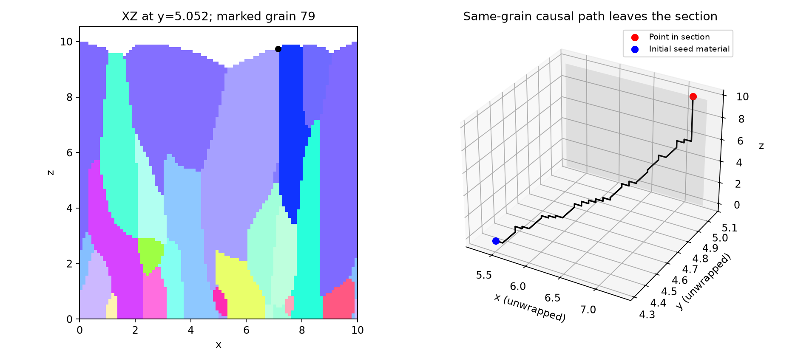

# 3次元ファセット膜成長：モデルと検証範囲

結果と検証の全体像は[図付き再現報告書](reproduction_report.md)を参照。
本資料は成長則、パラメータ、実行方法を説明する。

## 目的と出典

Smereka, Li, Russo and Srolovitz, *Simulation of faceted film growth in three dimensions:
microstructure, morphology and texture*, **Acta Materialia 53** (2005), 1191–1204.
[DOI:10.1016/j.actamat.2004.11.013](https://doi.org/10.1016/j.actamat.2004.11.013)。
Zotero `H935PNAT` の本文・§3・§5・Appendix A を参照した。

提供された4枚の図に対応する、〈100〉寄り／〈111〉寄りの配向を示す条件の
**XZ断面IPF-Z図とXY表面高さ図**を計算する。元のChatGPTコード・パラメータ・
乱数seedが不明なため、同一画像の再生成ではなく、明示した条件による定性的な再現を目標とする。
画像に合わせて核の位置・方位・成長速度を調整していない。

## 条件

| 項目 | 設定 |
|---|---|
| 計算領域 | XYは10×10、周期境界、Z下端は基板、上端は成長域の外 |
| 初期核 | 121粒、同じseed=2で両条件に同じ位置・方位を使用 |
| 方位 | SO(3)上で一様。極角そのものを一様にはしない |
| 初期核形状 | 半径0.24の球とZ≥0の共通部分、中心Z=0。両条件で同じ形から開始 |
| 核位置 | XY一様候補、周期距離0.51未満を棄却して初期重なりを防ぐ |
| 成長速度 | V111=1、V001=α/√3 |
| 〈111〉寄り条件 | α=1.1（論文Fig. 3） |
| 〈100〉寄り条件 | α=2.9（論文Fig. 5）。立方晶では〈100〉と〈001〉は等価 |
| 出力時刻 | t=10。**時間tと平均膜厚hは異なる** |
| 分解能比較 | XY=64²と96²、等方格子、Zは速度上限から自動決定 |
| 時間刻み | Δt=0.6 Δx / max(vertexのL1ノルム)。最後のstepだけ調整 |
| XZ断面 | Y格子の中央列。偶数格子なので厳密なy=5ではなく5+Δx/2 |

球状初期核は、微小な回転多面体を格子化した際に角のvoxelが面連結でなくなる問題を
避けるための選択であり、原論文の初期形状をそのまま再現したという意味ではない。
各核の初期voxel集合の周期境界を含む面連結性・基板との接触を計算前に検査し、
満たさなければ中止する。成長後の断面の孤立片を削除する処理は行わない。
孤立結晶の解析解との比較専用には、より大きいWulff形初期核を使用する。

平均初期核間距離は `d0 = 10/√121 ≈ 0.9091`。図の軸は計算長さ単位であり、
論文のh/d0と比較する際は変換する。論文の横250²格子、十数試行の平均に比べて
本計算は粗く、1乱数試行なので、論文の統計精度に達した結果ではない。

`100`・`111`という出力名はここで選んだ**繊維配向の条件**を表す。
元画像のファイル名が同じ意味で使われたかは不明。ファセット指数 `{hkl}` と
配向方向 `〈hkl〉` を混同しない。

## 成長則と著者実装との差

単結晶の kinetic Wulff 体を次の14半空間の交差で構成する。

```
W = { q : n_f · q <= V_f }
{001}: 6法線、速度V001
{111}: 8法線、速度V111
α = √3 V001 / V111
```

粒ごとにレベルセット場 `φ_g` を持ち、`φ_g < 0`を粒の内部とする。
回転したWulff体の頂点から、凸な支持関数型Hamiltonian

```
H_g(p) = max(0, max_{v in R_g W} v · p)
∂φ_g/∂t + H_g(∇φ_g) = 0
```

を一次風上差分で進める。正負の速度成分に応じて片側差分を選び、上記CFL条件下で
各候補更新が非負係数の組合せになる。単結晶の孤立したファセットに所定速度を与えるが、
**これは論文式(7)の `c(n)=w_k+r√(1−(n·n_k)²)` をそのまま解いたものではない**。
同じWulff体を持つことだけから、衝突後の粒界まで著者ソルバと等価とは結論しない。

- 既に別粒が占有する格子点を、その粒にとって正の場を持つ障害物とする。
- すべての粒は同じstep開始時の占有状態を参照して更新する。
- 同stepで複数粒が零交差した場合は、float64で線形補間した到達時刻で決める。
  完全同時の場合は小さい粒IDを優先する。
- 一度堆積した粒IDは固定。面隣接する既存の同粒材料からしか占有を増やせない。
- 各新規voxelに同粒の先行voxelと到達時刻を記録し、粒ID一致・周期距離での面隣接・
  厳密な時刻減少を全voxelで確認する。初期核の連結性検査と合わせて基板への連鎖を監査する。
- 周期境界を使い、領域外の核を窓端に押し込む処理は行わない。
- 界面から遠い場はクリップし、活動中の前線周辺だけを更新する。
  著者らの再初期化手法は再実装していない。帯幅依存性を別途測定する。

単なる自由成長体の包絡面や `argmin τ_g` による空間分割ではない。
ただし、一次精度の数値拡散による角の丸まりや微小粒の消滅には格子依存性がある。
現在は**検証付きの予備的な3次元近似**であり、定量的な論文再現を達成したとはしていない。

## なぜ断面内で「途中から粒が現れる」のか

論文§5・Fig. 9は、3次元粒が断面外で基板につながっていても、その断面だけを見ると
途中で現れたり消えたりすることを明記している。これ自体は新規核生成ではない。

そのため、本計算では断面を塗り直したり、底面につながらない断面片を削除したりしない。
元の3次元粒IDと先行voxelの連鎖で検査する。IPF色は方位を示し、粒IDではないので、
同色の別粒も存在する。

## IPF色・表面高さ・統計量

- IPFの参照方向は試料Z軸。結晶座標で `Rᵀ Z` を求め、立方対称性で
  `0 <= a <= b <= c` に折り畳む。
- RGBは `(c−b, √2(b−a), √3 a)` に平方根補正と最大値規格化を適用する。
  001=赤、011=緑、111=青。色キーも出力する。市販EBSDソフトや元図のRGBとの完全一致は未確認。
- 表面高さは各XY列で最も高い占有voxelの中心。高さのサンプリング誤差は別途存在する。
- 平均膜厚は `mean(height)`、RMS粗さは `std(height)`（Appendix A.2）。
  初期の未被覆列は高さ0として含む。被覆率とその有無をJSONに記録し、未被覆の段階を
  連続膜の粗さとして論文と比較しない。
- 完全に埋まった水平断面では、粒ID数Ngと `d=√(A/Ng)` を記録する（Appendix A.1）。
- 配向の表面統計はXY投影面積で重み付け。核数による重み付けとは区別する。
- 121核・t=10の単一試行から `d ∝ h^(2/5)` や粗さの漸近指数の再現を主張しない。

## 再実行

リポジトリ直下で実行する。全3次元場はNPZに保存する。

```bash
uv sync
NUMBA_NUM_THREADS=4 uv run pytest -q
NUMBA_NUM_THREADS=4 uv run bin/validate3d.py
NUMBA_NUM_THREADS=4 uv run bin/faceted3d.py --alpha 1.1 --nx 96 --prefix 111 --out results/3d/n96
NUMBA_NUM_THREADS=4 uv run bin/faceted3d.py --alpha 2.9 --nx 96 --prefix 100 --out results/3d/n96
```

`--nx 64`を指定すると粗格子比較用。再現には核数・seed・初期半径を変えない。
初期核が格子で解像できない場合や重なる場合はエラーとし、無言で削除しない。

## 検証

[自動テスト](../tests/test_faceted3d.py)は以下を確認する。

1. Wulff体の半空間条件・活性ファセット速度・頂点数・最速配向の理論値。
2. IPFの3端点・立方対称性・回転行列の方向規約・初期方位の等方性。
3. 平面レベルセットの1step更新が解析的支持速度と一致。
4. 他粒の不透過層を挟むと背後に粒が再出現しない。同じ系の層なし対照では到達する。
5. 周期方向に整数格子分移動した初期条件から同じだけ移動した結果が得られる。
6. 堆積済みIDが変わらず、全成長voxelの先行点が同粒で時刻が厳密に早い。

[収束検査スクリプト](../bin/validate3d.py)は、回転した孤立Wulff体について
初期半径・方位・時間を固定して32/48/64格子を比較する。比較範囲は長さ6の箱。
空白領域を含めた見かけの高一致率ではなく、解析的結晶体積に対する対称差を報告する。
同じ細格子で時間刻み半減と帯幅5→8格子の感度も測定する。

[数値検証結果](../results/3d/validation.json)に実測値を保存する。
単結晶の対称差はα=1.1で30.9%→19.6%→14.6%、α=2.9で28.5%→15.4%→10.1%。
減少は確認したが、最細格子でも誤差は残る。時間刻み半減時の占有領域変化は
約1.2%／2.1%、帯幅変更時は約0.5%／1.0%。この測定を「誤差ゼロ」「収束済み」とは表現しない。

さらに t=0.75 と1.5の結晶から上向きファセットの支持位置を測り、速度も比較した。
最細格子でα=1.1の{001}速度誤差は約−1.5〜−2.1%、{111}は約−6.2〜−9.8%。
α=2.9では{001}が約−5.4〜−8.2%、{111}が約−1.8〜−2.8%。
面の種類ごとに誤差が違うため、入力した速度比が数値的に完全に維持されたとはいえない。
添付された参考図より稜が丸くなることも含め、微細なファセット形状の定量再現は未達である。

## 生成結果（96²、t=10）


| 条件 | XZ断面 | 表面高さ | 平均膜厚 | RMS粗さ | 表面粒数 |
|---|---|---|---:|---:|---:|
| α=2.9、〈100〉寄り | [IPF-Z](../results/3d/n96/100_cross_section_xz_ipf.png) | [高さ](../results/3d/n96/100_surface_height.png) | 15.526 | 0.599 | 16 |
| α=1.1、〈111〉寄り | [IPF-Z](../results/3d/n96/111_cross_section_xz_ipf.png) | [高さ](../results/3d/n96/111_surface_height.png) | 9.550 | 0.308 | 34 |

α=2.9では表面投影面積の81.9%が〈001〉から15°以内、α=1.1では65.3%が
〈111〉から15°以内となった。配向の選択と柱状組織が得られている。
初期核における同角度範囲の割合は、それぞれ核数重みで8.3%と11.6%である。
この初期割合と表面割合では重み付けが異なるため、同一の面積割合の時系列ではない。

提供された参考図とは、核配置、色規約、絶対高さ、表面の稜の鋭さが異なる。
本結果を参考図の完全再現や原論文の定量的再現とは呼ばない。
特に表面の四角形／三角形ファセットの明瞭さには改善が必要である。

### 格子依存性

同じ初期核位置・方位・半径で64²→96²としたときの変化：

| 条件 | 平均膜厚 | RMS粗さ | 表面粒数 |
|---|---:|---:|---:|
| α=1.1 | +3.46% | −5.69% | 32→34 |
| α=2.9 | +2.46% | +4.32% | 16→16 |

[格子比較と全監査結果](../results/3d/grid_comparison.json)に実測値を保存した。
この2格子の差だけで収束完了とは判定しない。

### 「途中から現れる粒」の3次元検証

96²の2条件、計2,221,601個の成長voxelについて、先行点の粒ID一致・面隣接・時刻減少を
全件確認した。初期核にも孤立片はなく、基板への連結性が保たれている。
一方、中央XZ断面には基板に接しない断面片が15個／16個ある（4画素以上）。
これは3次元全体での孤立粒数ではない。



例では粒ID 79を117個の先行voxelでたどると、断面y=5.052の外側（y≈4.323）を経由して
基板に接する初期核へ戻る。[〈100〉条件の接続例](../results/3d/100_section_connection.png)も保存した。
経路は同粒材料の接続を示すものであり、原子の輸送軌跡ではない。

全粒ID、到達時刻、先行voxel、初期核、方位行列、表面高さ、時間履歴は
[〈100〉条件のNPZ](../results/3d/n96/100_state.npz)と
[〈111〉条件のNPZ](../results/3d/n96/111_state.npz)に保存している。
[比較・接続例の生成スクリプト](../bin/compare3d.py)で再監査できる。

```bash
uv run bin/compare3d.py
```

20件のテスト（既存2Dの10件と新規3Dの10件）に合格。
これは実装上の検査結果であり、原論文との等価性や物理モデルの完全な妥当性を保証しない。
